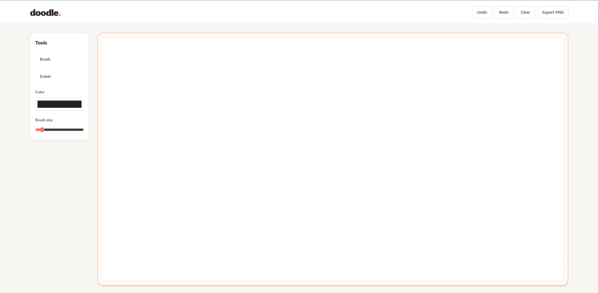
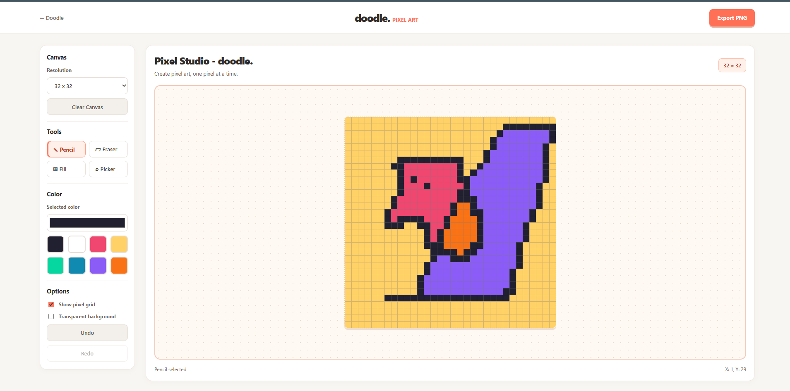

# Doodle — Be Creative.

## Doodle ! - Your Canvas - Your Pixel Art - Your Styles - Your Doodles
Doodle is a browser-based drawing application designed to make digital art simple and accessible. It started with a canvas for freehand drawing and grew into a two-part creative workspace, combining a general-purpose drawing editor with a dedicated Pixel Art studio.

The main editor supports freehand sketches, adjustable brush sizes, color selection, geometric shapes, arrows, and text. Pixel Art extends the experience with a resolution-based canvas for creating pixel illustrations, complete with specialized editing tools and transparent PNG export.

## Screenshots

### Drawing Canvas

## What You Can Create

- **Freehand drawings:** Sketch using the brush and eraser with adjustable brush sizes.
- **Shapes and annotations:** Add lines, rectangles, circles, arrows, and text.
- **Pixel illustrations:** Create artwork on 16×16, 24×24, 32×32, 48×48, or 64×64 canvases.
- **Pixel-level editing:** Use pencil, eraser, fill, and eyedropper tools.
- **Color customization:** Pick custom colors or choose from a preset palette.
- **Canvas controls:** Toggle the pixel grid and transparent background.
- **Editing history:** Undo and redo changes.
- **Image export:** Save your pixel artwork as a PNG.

### Pixel Art Studio

## Pixel Art 
- **Use Pencil:** To free had pixel draw.  
- **Use Eraser:** To erase drawn parts.
- **Use Fill:** To fill a color enitrerly - border vary.
- **Use Picker:** To pick a color and use with the tools .
- **Enable Grid** & **Enable Transparent Background**.

## Built With

- HTML5
- CSS3
- Vanilla JavaScript
- HTML Canvas API - thing i learned while building doodle !!! 

Used AI assistance - (about 15-20% of build is AI generated) "only" throughout development for feature implementation, and refining the editor's functionality. AI helped with the HTML structure, CSS styling, JavaScript logic, pixel-drawing interpolation, flood-fill implementation, transparent backgrounds functionality.

**Doodle — Be Creative.**
- ~ Yousuf 
